# Emerald

Patches, screenshots and source changes for Emerald. See the [main README](../README.md)
for how to apply a patch, what changed in battle, how to build, and how the screenshots
were made.

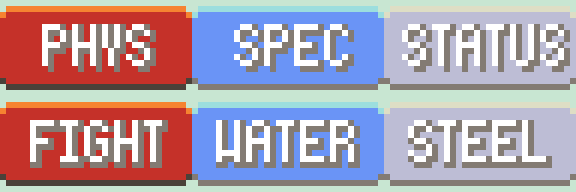

## Supported ROMs

| Patch file | Use it on | CRC32 | SHA-1 |
|---|---|---|---|
| `Emerald_PhysSpecSplit.bps` | **Pokémon Emerald Version (USA, Europe)**, game code `BPEE` | `1F1C08FB` | `f3ae088181bf583e55daf962a92bb46f4f1d07b7` |

* Only the **English (USA, Europe)** release is supported, not other languages. It has
  only one revision.

## In-game

**Summary screen → BATTLE MOVES → press A on a move.** A PHYS / SPEC / STATUS badge appears
at the right end of the DESCRIPTION header, next to the move's description and POWER /
ACCURACY. This is also the screen you get when you **learn a new move by level-up or TM
with four moves already known**, so you can see the new move's category before you choose
a move to forget. The badge isn't shown on the CONTEST MOVES page.

| Special | Physical | Status |
|---|---|---|
| 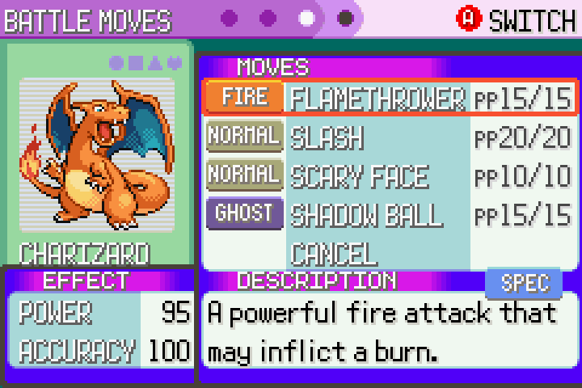 | 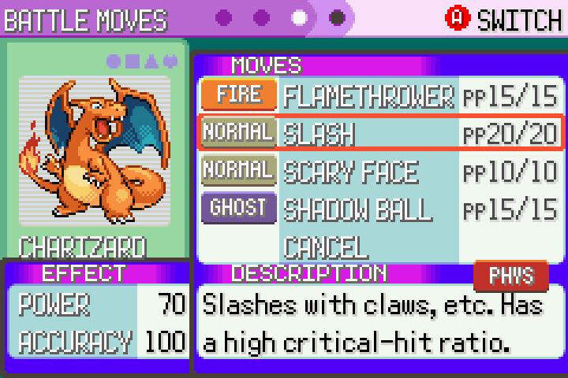 | 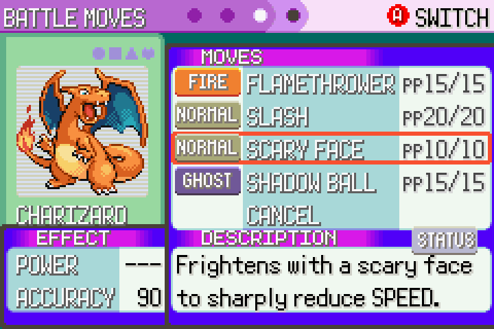 |

| Learning a new move (Earthquake) | Shadow Ball is now Special |
|---|---|
| 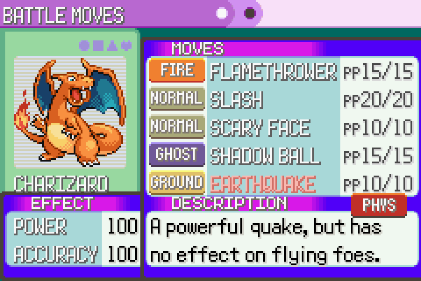 | 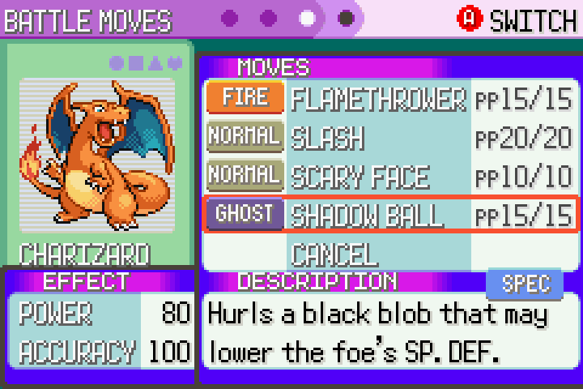 |

**Move Relearner** (Fallarbor Town): the BATTLE MOVES panel has a new third row with the
category, under the type and PP.

| Physical | Status | Special |
|---|---|---|
| 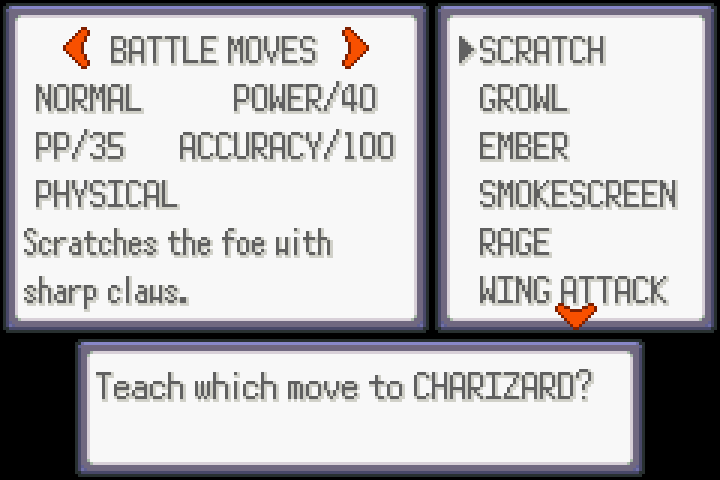 | 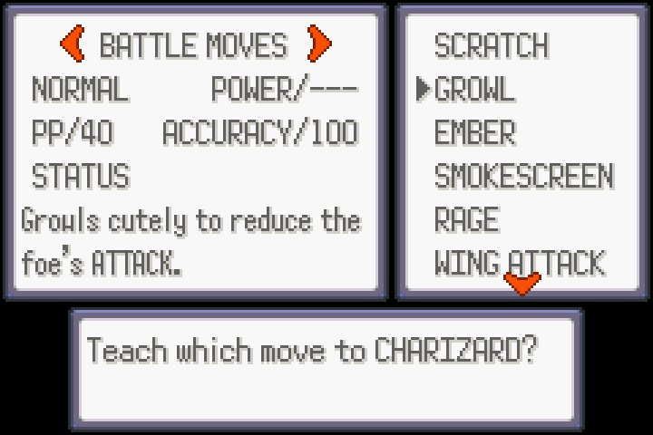 | 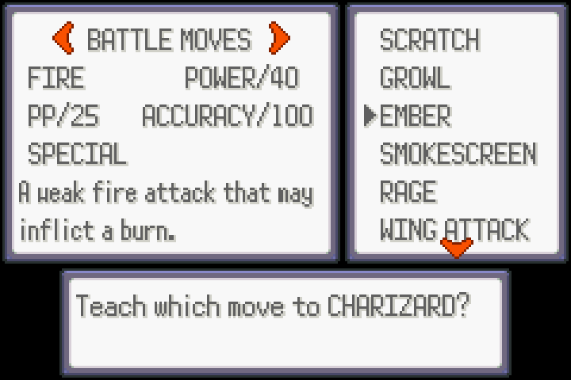 |

**Bag → TMs & HMs pocket:** the selected TM/HM's type and category are shown stacked in the
empty space beside the bag (they hide on CLOSE BAG and in the other pockets).

| Status | Physical | Special |
|---|---|---|
| 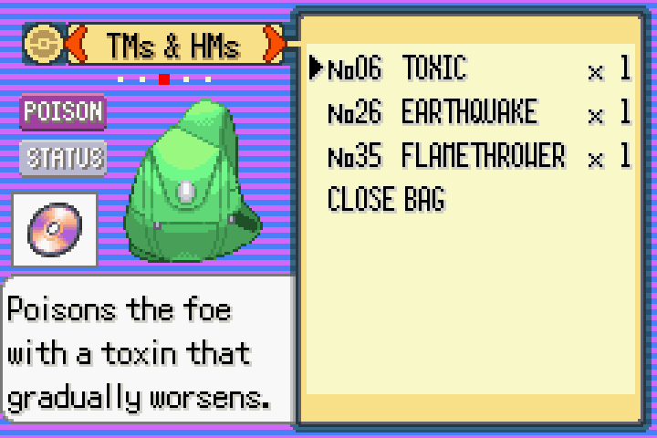 | 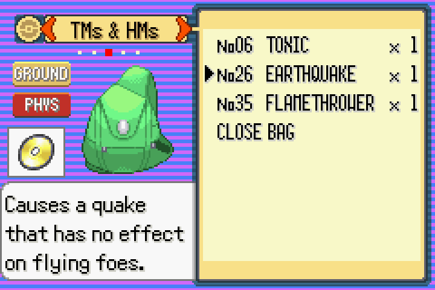 | 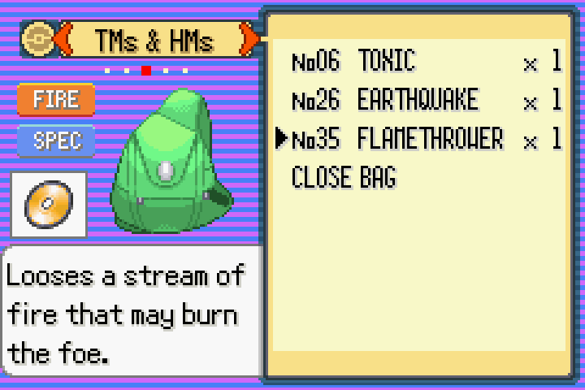 |

## Emerald-only battle change

The Battle Frontier TV "Battle Seminar" show scores Reflect and Light Screen by the
attacking move's category too (`src/battle_tv.c`).

## Source changes

Built from [pret/pokeemerald](https://github.com/pret/pokeemerald) at commit
`731ad5bfd6e6f265508d0efcca0ba42f9dcf5881`. Every change is in
[`source/phys-spec-split.diff`](source/phys-spec-split.diff). Test-only code is kept separately
in [`tests/`](tests/) and never goes into a patch.

| File | Change |
|---|---|
| `include/constants/pokemon.h` | `SPLIT_PHYSICAL` / `SPLIT_SPECIAL` / `SPLIT_STATUS` constants (here so the AI script can use them too) |
| `include/pokemon.h` | new `u8 split;` field in `struct BattleMove` (uses existing padding; still 12 bytes per move) |
| `src/data/battle_moves.h` | `.split = SPLIT_…,` added to every move |
| `include/battle.h` | `IS_MOVE_PHYSICAL(move)` / `IS_MOVE_SPECIAL(move)` replace the old type-based macros |
| `src/pokemon.c` | `CalculateBaseDamage` picks stats by the move's category |
| `src/battle_script_commands.c` | Hustle accuracy, Counter/Mirror Coat damage tracking |
| `src/battle_tv.c` | Battle Seminar Reflect/Light Screen scoring |
| `graphics/types/split_physical.png`, `split_special.png`, `split_status.png` | the three badges (new files, 32×16, same palettes as the type icons) |
| `graphics_file_rules.mk` | appends the badges to the type-icon sprite sheet |
| `src/pokemon_summary_screen.c` | badge sprite (`SPRITE_ARR_ID_SPLIT`, `SpriteCB_SplitIcon`), shown while battle move details are open (`splitIconMove`) |
| `src/menu_specialized.c` | Move Relearner: rows moved up 8 px and a category row added (`MoveRelearnerLoadBattleMoveDescription`) |
| `include/pokemon_summary_screen.h` | shares the move type icon sprite sheet/animations/palette map (`gSpriteSheet_MoveTypes` etc.) with the bag |
| `src/item_menu.c`, `include/item_menu.h` | Bag TMs & HMs pocket: type + category icons (`LoadTmIconGfx`, `CreateTmIconSprites`, `SpriteCB_TmIcon`; selected move kept in `gBagMenu->tmMove`) |
| `src/battle_ai_script_commands.c` | trainer AI: new script commands in the unused slots 0x52–0x54: `get_move_split_from_result`, `if_target_physical_attacker`, `if_target_special_attacker` (the target's Attack vs Sp. Atk) |
| `asm/macros/battle_ai_script.inc` | macros for those commands |
| `data/battle_ai_scripts.s` | the AI's type lists for Reflect, Light Screen, Counter, Mirror Coat, Attack/Sp. Atk drops and Defense/Sp. Def boosts replaced by those commands |

### Common edits

* **Change a move's category:** edit its `.split` in `src/data/battle_moves.h`, e.g.
  ```c
  [MOVE_BITE] = { ..., .split = SPLIT_PHYSICAL, },
  ```
* **Change the badge art:** edit `graphics/types/split_*.png`. Keep them 32×16 indexed
  PNGs using the type-icon palettes (`move_types_1.pal` for PHYS/STATUS, `move_types_2.pal`
  for SPEC; see `sMoveTypeToOamPaletteNum`).
* **Move the badge on screen:** change `SPLIT_ICON_X` / `SPLIT_ICON_Y` at the top of
  `pokemon_summary_screen.c`, or `TM_ICON_X` / `TM_ICON_Y` in `item_menu.c` for the Bag.
* **Rename the relearner text:** `sText_SplitPhysical` etc. in `menu_specialized.c`.

## Build targets

`tools/setup.sh emerald` creates a working copy in `work/pokeemerald`; [`game.conf`](game.conf) holds these
targets for the scripts. See [docs/DEVELOPING.md](../docs/DEVELOPING.md) for the rest.

| Patch | `make` target | Built ROM | Vanilla `compare` target |
|---|---|---|---|
| `Emerald_PhysSpecSplit.bps` | all (plain `make`) | `pokeemerald.gba` | `compare` |

