# FireRed & LeafGreen

Patches, screenshots and source changes for FireRed & LeafGreen. See the [main
README](../README.md) for how to apply a patch, what changed in battle, how to build, and
how the screenshots were made.

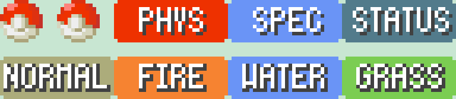

## Supported ROMs

| Patch file | Use it on | CRC32 | SHA-1 |
|---|---|---|---|
| `FireRed_PhysSpecSplit_v1.0.bps` | **Pokémon FireRed Version (USA) v1.0**, game code `BPRE`, revision 0 | `DD88761C` | `41cb23d8dccc8ebd7c649cd8fbb58eeace6e2fdc` |
| `FireRed_PhysSpecSplit_v1.1.bps` | **Pokémon FireRed Version (USA) v1.1 (Rev 1)**, game code `BPRE`, revision 1 | `84EE4776` | `dd5945db9b930750cb39d00c84da8571feebf417` |
| `LeafGreen_PhysSpecSplit_v1.0.bps` | **Pokémon LeafGreen Version (USA) v1.0**, game code `BPGE`, revision 0 | `D69C96CC` | `574fa542ffebb14be69902d1d36f1ec0a4afd71e` |
| `LeafGreen_PhysSpecSplit_v1.1.bps` | **Pokémon LeafGreen Version (USA) v1.1 (Rev 1)**, game code `BPGE`, revision 1 | `DAFFECEC` | `7862c67bdecbe21d1d69ce082ce34327e1c6ed5e` |

* Use the **FireRed** patches on FireRed and the **LeafGreen** patches on LeafGreen. They
  aren't interchangeable.
* Only the **English (USA)** releases are supported, not European or Japanese ones.
* Not sure which revision you have? Try the v1.0 patch first. If the patcher refuses it
  ("source checksum mismatch"), use v1.1.

## In-game

**Summary screen → Moves → press A on a move.** The badge sits to the right of the POWER
box. This is also the screen you get when you **learn a new move by level-up or TM with
four moves already known**, so you can see the new move's category before you choose a
move to forget.

| Special | Physical | Status |
|---|---|---|
| 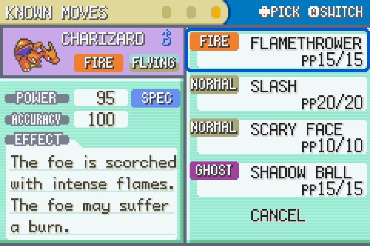 | 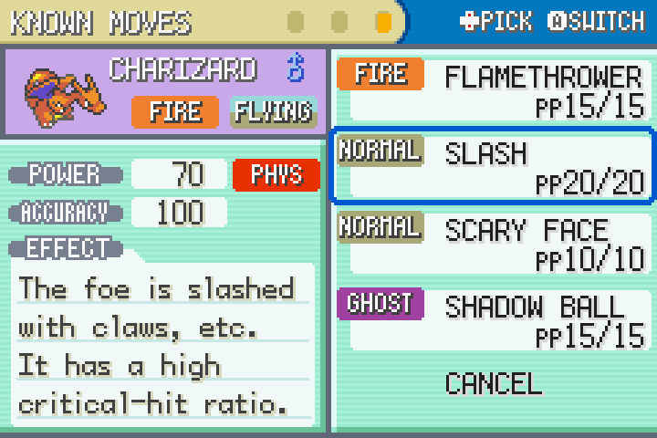 | 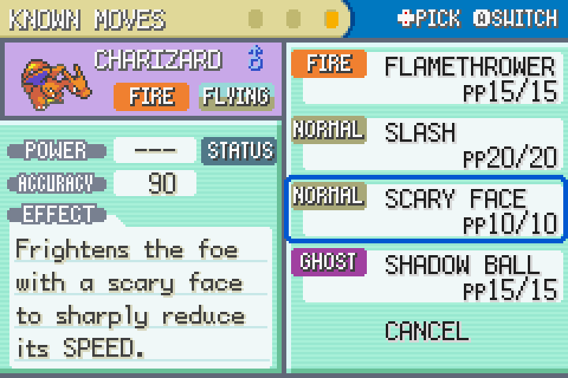 |

| Learning a new move (Earthquake) | Shadow Ball is now Special |
|---|---|
| 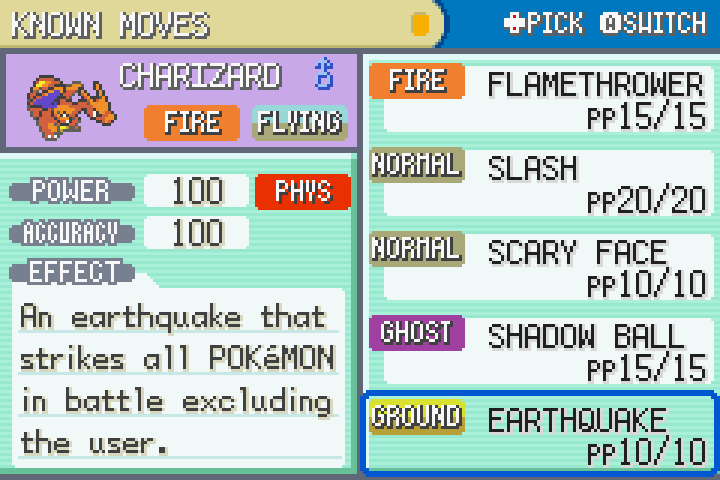 | 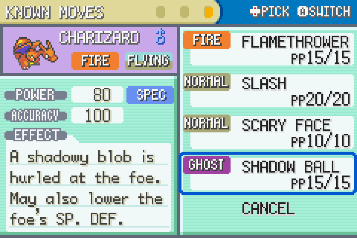 |

**Move Relearner** (Two Island move tutor): the badge appears under the ACCURACY label.

| Special | Physical | Status |
|---|---|---|
| 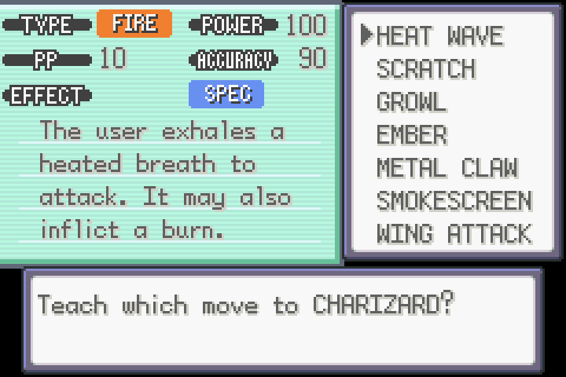 | 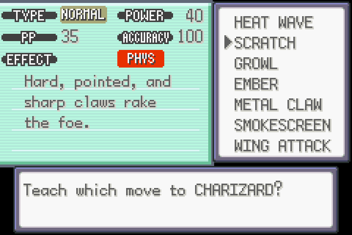 | 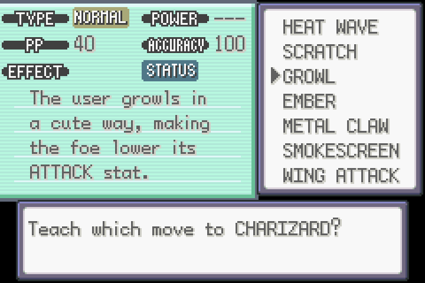 |

**TM Case:** the first row of the move info box shows the type and category side by side
(in place of the old "TYPE" label).

| Status | Physical | Special |
|---|---|---|
| 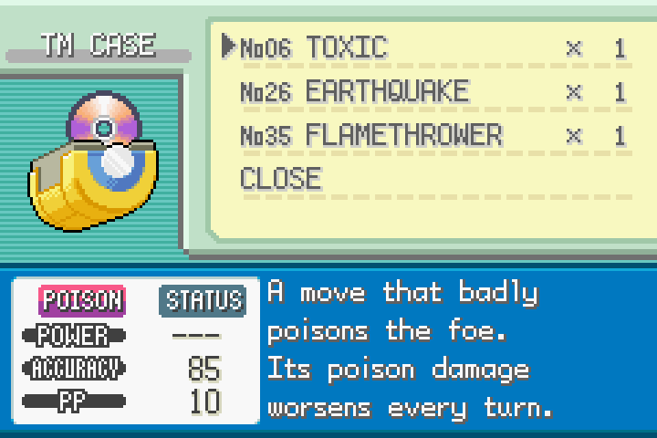 | 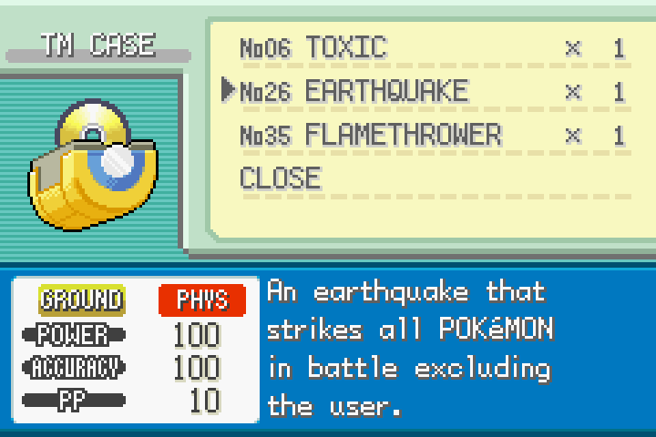 | 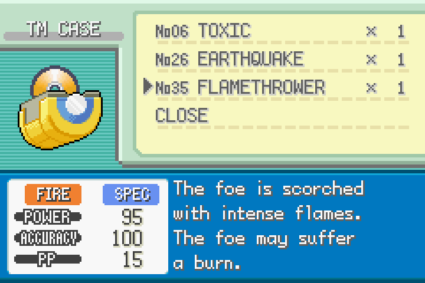 |

(The screenshots are from LeafGreen; FireRed looks the same.)

## Source changes

Built from [pret/pokefirered](https://github.com/pret/pokefirered) at commit
`ce6406d8c2eaf46d543c8a2606de0c3cb1951982`. Every change is in
[`source/phys-spec-split.diff`](source/phys-spec-split.diff). Test-only code is kept separately
in [`tests/`](tests/) and never goes into a patch.

| File | Change |
|---|---|
| `include/constants/pokemon.h` | `SPLIT_PHYSICAL` / `SPLIT_SPECIAL` / `SPLIT_STATUS` constants |
| `include/pokemon.h` | new `u8 split;` field in `struct BattleMove` (uses existing padding; still 12 bytes per move) |
| `src/data/battle_moves.h` | `.split = SPLIT_…,` added to every move |
| `include/battle.h` | `IS_MOVE_PHYSICAL(move)` / `IS_MOVE_SPECIAL(move)` replace the old type-based macros |
| `src/pokemon.c` | `CalculateBaseDamage` picks stats by the move's category |
| `src/battle_script_commands.c` | Hustle accuracy, Counter/Mirror Coat damage tracking |
| `graphics/interface/menu_info.png` | PHYS / SPEC / STATUS badges added to the top row (x = 32, 64, 96) |
| `include/menu.h`, `src/list_menu.c` | `MENU_INFO_ICON_PHYSICAL/SPECIAL/STATUS` icon IDs |
| `src/pokemon_summary_screen.c` | draws the badge in `PokeSum_PrintSelectedMoveStats` |
| `src/learn_move.c` | new window 8 + badge in `PrintMoveInfo` (Move Relearner) |
| `src/tm_case.c` | TM Case: "TYPE" label dropped; type + category badges on the first row (`DrawMoveInfoLabels`, `PrintMoveInfo`) |
| `src/battle_ai_script_commands.c` | trainer AI: new script commands in the unused slots 0x52–0x54: `get_move_split_from_result`, `if_target_physical_attacker`, `if_target_special_attacker` (the target's Attack vs Sp. Atk) |
| `asm/macros/battle_ai_script.inc` | macros for those commands |
| `data/battle_ai_scripts.s` | the AI's type lists for Reflect, Light Screen, Counter, Mirror Coat, Attack/Sp. Atk drops and Defense/Sp. Def boosts replaced by those commands |

### Common edits

* **Change a move's category:** edit its `.split` in `src/data/battle_moves.h`, e.g.
  ```c
  [MOVE_BITE] = { ..., .split = SPLIT_PHYSICAL, },
  ```
* **Change the badge art:** edit `graphics/interface/menu_info.png`. Keep it an indexed
  PNG and draw in the top row using the existing palette's second row (indices 16–31).
  Each badge is 32×12. The build converts it automatically.
* **Move the badge on screen:** change the `x, y` passed to `BlitMenuInfoIcon` in
  `pokemon_summary_screen.c` / `learn_move.c` / `tm_case.c`.

## Build targets

`tools/setup.sh firered-leafgreen` creates a working copy in `work/pokefirered`; [`game.conf`](game.conf) holds these
targets for the scripts. See [docs/DEVELOPING.md](../docs/DEVELOPING.md) for the rest.

| Patch | `make` target | Built ROM | Vanilla `compare` target |
|---|---|---|---|
| `FireRed_PhysSpecSplit_v1.0.bps` | `firered` | `pokefirered.gba` | `compare_firered` |
| `FireRed_PhysSpecSplit_v1.1.bps` | `firered_rev1` | `pokefirered_rev1.gba` | `compare_firered_rev1` |
| `LeafGreen_PhysSpecSplit_v1.0.bps` | `leafgreen` | `pokeleafgreen.gba` | `compare_leafgreen` |
| `LeafGreen_PhysSpecSplit_v1.1.bps` | `leafgreen_rev1` | `pokeleafgreen_rev1.gba` | `compare_leafgreen_rev1` |

