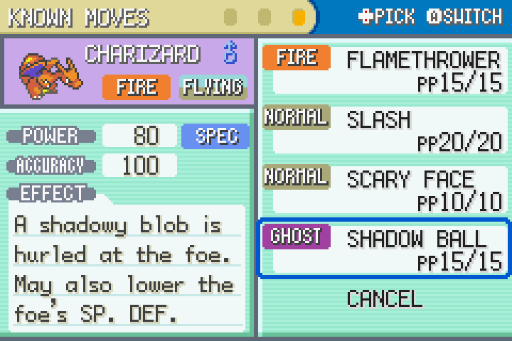
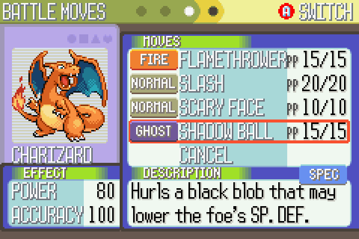
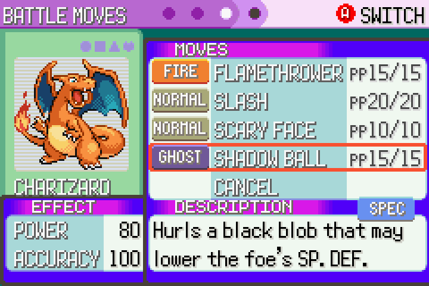
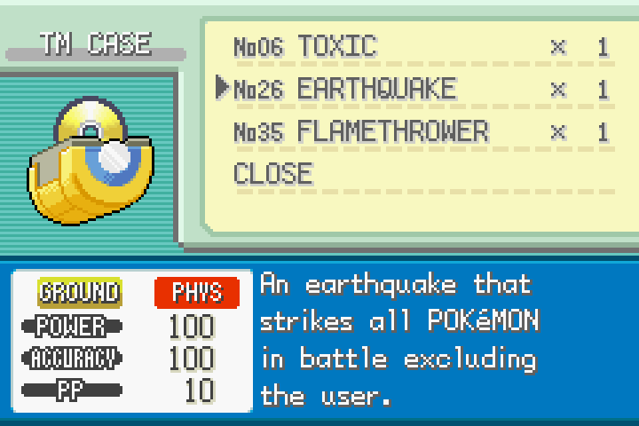
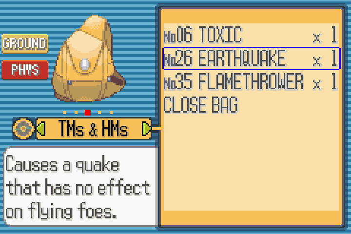
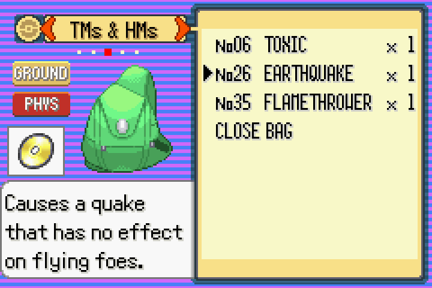

# Gen 3 Physical/Special Split

Patches that give the Game Boy Advance Pokémon games the **Gen 4 physical/special split**.
Each move is Physical, Special or Status based on the move itself, not its type, using its
Diamond/Pearl/Platinum category. The games also show each move's category in-game: on the
summary screen, when learning a move, at the Move Relearner/Tutor, and in the TM Case or
Bag. The trainer AI is updated to reason about the categories too.

| FireRed / LeafGreen | Ruby / Sapphire | Emerald |
|---|---|---|
|  |  |  |
|  |  |  |

Each game's README has screenshots of every changed screen.

## Supported ROMs

Find your ROM, then use that patch. Each game's README has the SHA-1s and game-specific
notes.

| Your ROM (clean, English) | Patch | ROM CRC32 |
|---|---|---|
| FireRed (USA) v1.0 | [`FireRed-LeafGreen/`](FireRed-LeafGreen/README.md)`FireRed_PhysSpecSplit_v1.0.bps` | `DD88761C` |
| FireRed (USA) v1.1 | [`FireRed-LeafGreen/`](FireRed-LeafGreen/README.md)`FireRed_PhysSpecSplit_v1.1.bps` | `84EE4776` |
| LeafGreen (USA) v1.0 | [`FireRed-LeafGreen/`](FireRed-LeafGreen/README.md)`LeafGreen_PhysSpecSplit_v1.0.bps` | `D69C96CC` |
| LeafGreen (USA) v1.1 | [`FireRed-LeafGreen/`](FireRed-LeafGreen/README.md)`LeafGreen_PhysSpecSplit_v1.1.bps` | `DAFFECEC` |
| Ruby (USA, Europe) v1.0 | [`Ruby-Sapphire/`](Ruby-Sapphire/README.md)`Ruby_PhysSpecSplit_v1.0.bps` | `F0815EE7` |
| Ruby (USA, Europe) Rev 1 | [`Ruby-Sapphire/`](Ruby-Sapphire/README.md)`Ruby_PhysSpecSplit_v1.1.bps` | `61641576` |
| Ruby (USA, Europe) Rev 2 | [`Ruby-Sapphire/`](Ruby-Sapphire/README.md)`Ruby_PhysSpecSplit_v1.2.bps` | `AEAC73E6` |
| Sapphire (USA, Europe) v1.0 | [`Ruby-Sapphire/`](Ruby-Sapphire/README.md)`Sapphire_PhysSpecSplit_v1.0.bps` | `554DEDC4` |
| Sapphire (USA, Europe) Rev 1 | [`Ruby-Sapphire/`](Ruby-Sapphire/README.md)`Sapphire_PhysSpecSplit_v1.1.bps` | `BAFEDAE5` |
| Sapphire (USA, Europe) Rev 2 | [`Ruby-Sapphire/`](Ruby-Sapphire/README.md)`Sapphire_PhysSpecSplit_v1.2.bps` | `9CC4410E` |
| Emerald (USA, Europe) | [`Emerald/`](Emerald/README.md)`Emerald_PhysSpecSplit.bps` | `1F1C08FB` |

* The ROM must be a **clean, unmodified** dump of that exact version. Other languages and
  already-hacked ROMs aren't supported.
* Not sure which revision you have? BPS patches check the original ROM's checksum, so a
  patcher refuses the wrong one: try each patch for your game in turn. You can also
  compare your ROM's CRC32 (Rom Patcher JS shows it) or SHA-1 (`shasum rom.gba`).
* The patches don't change the save format, so **existing saves keep working**. Back up
  your `.sav` first anyway.

## How to apply a patch

Any BPS patcher works. For example:

**Rom Patcher JS (browser, any OS):**
1. Open <https://www.marcrobledo.com/RomPatcher.js/>.
2. *ROM file*: choose your clean `.gba`.
3. *Patch file*: choose the matching `.bps`.
4. Click **Apply patch** and save the new `.gba`.

**Floating IPS (Flips), Windows/Linux:** click **Apply Patch**, select the `.bps`, then your
clean ROM, then where to save the patched ROM.

**mGBA soft-patching (no new file is written):** put the `.bps` next to the ROM with the
same file name (e.g. `Pokemon Emerald.gba` + `Pokemon Emerald.bps`) and mGBA applies it on
load. Or from a terminal: `mGBA -p Emerald_PhysSpecSplit.bps "Pokemon Emerald.gba"`.

**Command line (Python 3, no dependencies):**
```sh
python3 bps.py apply "Pokemon Emerald.gba" Emerald/Emerald_PhysSpecSplit.bps "Emerald Split.gba"
```

Then play the patched `.gba` in any GBA emulator or on a flash cart.

## What changed in battle

The same in every game:

* Each move has a category (`split`) taken from its Gen 4 category.
* Damage uses **Attack/Defense for Physical moves and Sp. Atk/Sp. Def for Special moves**,
  whatever the move's type. Reflect, Light Screen, burn, Guts, Hustle, Huge/Pure Power,
  Choice Band, crits that ignore stat stages, etc. all follow the category.
* **Counter** reflects Physical hits and **Mirror Coat** reflects Special hits.
* Type-boosting held items (Charcoal, Mystic Water, …) boost the stat that matches the
  move's category.
* Hidden Power and Weather Ball are always Special (as in Gen 4), whatever their type.

**28 moves are now Physical** (were Special): Fire Punch, Ice Punch, Thunder Punch, Vine
Whip, Bite, Razor Leaf, Waterfall, Clamp, Crabhammer, Thief, Flame Wheel, Faint Attack,
Outrage, Spark, Sacred Fire, Pursuit, Crunch, Beat Up, Knock Off, Dive, Blaze Kick, Ice
Ball, Needle Arm, Bullet Seed, Icicle Spear, Dragon Claw, Volt Tackle, Leaf Blade.

**26 moves are now Special** (were Physical): Razor Wind, Gust, Sonic Boom, Acid, Hyper
Beam, Night Shade, Smog, Sludge, Swift, Tri Attack, Snore, Aeroblast, Sludge Bomb, Mud
Slap, Hidden Power, Ancient Power, Shadow Ball, Uproar, Spit Up, Hyper Voice, Weather
Ball, Air Cutter, Silver Wind, Signal Beam, Mud Shot, Doom Desire.

Every other move keeps the category it already had.

### Why it matters

In the original games, a move's type decided which stat it used: Normal, Fighting, Flying,
Poison, Ground, Rock, Bug, Ghost and Steel moves were physical; Fire, Water, Grass,
Electric, Psychic, Ice, Dragon and Dark moves were special. Many Pokémon ended up with their
own type's moves running off their weaker attacking stat:

| Pokémon (base Attack / Sp. Atk) | Move | Original games | With this patch |
|---|---|---|---|
| **Gengar** (65 / 130) | Shadow Ball, Sludge Bomb | Physical: its own STAB moves used its weak Attack, so Gengar was usually given Psychic or Thunderbolt instead | Special: uses its 130 Sp. Atk |
| **Sneasel** (95 / 35) | Faint Attack | Special: its Dark STAB used one of the lowest Sp. Atk stats in the game | Physical: uses its 95 Attack |
| **Gyarados** (125 / 60) | Waterfall | Special: its Water STAB used its weak Sp. Atk, so it usually ran Normal and Ground moves instead | Physical: uses its 125 Attack |
| **Kingler** (130 / 50) | Crabhammer | Special: its signature move used its 50 Sp. Atk | Physical: uses its 130 Attack |
| **Crawdaunt** (120 / 90) | Crabhammer | Special | Physical: uses its 120 Attack |
| **Salamence** (135 / 110) | Dragon Claw | Special | Physical: uses its 135 Attack |

### Trainer AI

The AI decides whether some moves are worth using by guessing whether your Pokémon
attacks physically or specially. The original games guessed from **your Pokémon's types**
(using the same type-based lists as above), or from the **type of the move you last used**.
The patch changes these guesses to:

* **Your Pokémon's last move:** its actual category. Used for Counter, Mirror Coat, and
  Defense / Sp. Def boosts (e.g. Harden or Amnesia after you hit it).
* **Your Pokémon itself:** whichever of its Attack and Sp. Atk is higher (a tie counts as
  both). Used for Reflect, Light Screen, Attack / Sp. Atk drops (Growl, etc.), and Counter /
  Mirror Coat before you've attacked.

Measured with the [AI test](#ai-test) (average change to the move's score over 256 runs;
the AI usually picks its highest-scoring move, so a drop of 1–2 points makes a move much
less likely). FireRed shown; the other games differ by at most 0.15:

| Situation | AI's move | Before | After |
|---|---|---|---|
| vs a Gengar-like Pokémon (Ghost/Poison, Sp. Atk > Attack) | Reflect | +0.00 | −1.54 |
| | Light Screen | −1.61 | +0.00 |
| vs a Gyarados-like Pokémon (Water/Flying, Attack > Sp. Atk) | Light Screen | +0.00 | −1.55 |
| | Growl | −1.52 | +0.00 |
| after you used Shadow Ball | Counter | +0.59 | −1.00 |
| after you used Crunch | Mirror Coat | +0.61 | −1.00 |

So the AI now puts up Light Screen, not Reflect, against Gengar. It stops using Counter
on a special Shadow Ball (which Counter can't reflect) and Mirror Coat on a physical Crunch.

### Known limitations

* The category isn't shown in the battle move menu. Check it from the party summary
  screen, or the TM Case / Bag for TMs.
* The AI's guess about your Pokémon compares its Attack and Sp. Atk; it doesn't look at
  which moves it actually knows.

## Building from source

The patches are built from [pret](https://github.com/pret)'s decompilations, which compile
to byte-identical ROMs. Each game folder stores its changes as
`source/phys-spec-split.diff` against a pinned upstream commit, listed in
[`games.txt`](games.txt) along with the pinned agbcc compiler. Each game's README lists the
files changed, common edits, and its `make` targets.

| Games | Decomp | Setup name |
|---|---|---|
| FireRed / LeafGreen | [pret/pokefirered](https://github.com/pret/pokefirered) | `firered-leafgreen` |
| Ruby / Sapphire | [pret/pokeruby](https://github.com/pret/pokeruby) | `ruby-sapphire` |
| Emerald | [pret/pokeemerald](https://github.com/pret/pokeemerald) | `emerald` |

### Prerequisites

On macOS:
```sh
brew install arm-none-eabi-gcc arm-none-eabi-binutils libpng pkgconf
```
For Linux or Windows/WSL, install the packages listed in the decomp's `INSTALL.md`.

### With the helper scripts

```sh
./setup.sh emerald                  # clone, apply the diff, build agbcc -> work/pokeemerald
cd work/pokeemerald                 # edit the source here, then:
patch_tools/make_patches.sh "/path/to/clean Emerald.gba"   # pass one or more clean ROMs
../../export.sh emerald             # save the diff and the new .bps back into Emerald/
```

`make_patches.sh` identifies each clean ROM by its SHA-1, builds the matching game in a
fresh copy of the source (so leftover build files can't end up in a patch), writes the
`.bps`, and checks that the patch recreates the built ROM exactly. `export.sh` rewrites
`source/phys-spec-split.diff` and copies the patches into the game folder. Commit both.
`work/` is ignored by git.

### Without the scripts

The same steps by hand, using Emerald as the example (substitute the game's decomp,
commit from `games.txt`, and `make` target from its README):

```sh
# 1. pret's agbcc compiler
git clone https://github.com/pret/agbcc
cd agbcc && git checkout da598c1d918402c42c0c0d7128ba14567f3175e9 && ./build.sh && cd ..

# 2. the decomp at the pinned commit, with this repository's changes applied
git clone https://github.com/pret/pokeemerald
cd pokeemerald
git checkout 731ad5bfd6e6f265508d0efcca0ba42f9dcf5881
git apply --binary /path/to/gen3/Emerald/source/phys-spec-split.diff
(cd ../agbcc && ./install.sh ../pokeemerald)

# 3. build the modified ROM
make -j8                            # Emerald; e.g. `make firered_rev1` or `make ruby_rev2` for others

# 4. make the patch from your clean ROM and the built ROM, with any BPS tool
python3 /path/to/gen3/bps.py create "clean Emerald.gba" pokeemerald.gba Emerald_PhysSpecSplit.bps
#   or: flips --create --bps "clean Emerald.gba" pokeemerald.gba Emerald_PhysSpecSplit.bps
```

To save source edits back into this repository by hand, write the diff from the decomp's
directory. `git add -N` makes new files show up in the diff; `harness.diff` needs `-f`
because pret's `.gitignore` ignores `*.diff`. Delete any `__pycache__` folders first.
```sh
git add -N . && git add -N -f patch_tools/visual_test/harness.diff
git diff --binary --full-index HEAD -- . ':!patches' > /path/to/gen3/Emerald/source/phys-spec-split.diff
```

### Checking the original game still builds

After changing the pinned commit, build the untouched upstream code in a separate checkout
and compare it with the official ROM (use the game's `compare` target from its README):
```sh
cd work/pokeemerald
git worktree add --detach /tmp/vanilla-check HEAD
cp -R tools/agbcc /tmp/vanilla-check/tools/
make -C /tmp/vanilla-check -j8 compare
git worktree remove --force /tmp/vanilla-check
```

## How the screenshots were made

The screenshots aren't emulator screen captures. They're rendered from the game's own video
memory by a self-driving test build, so they show the GBA's own graphics at native
resolution. Each working copy from `setup.sh` has the test at
`patch_tools/visual_test/run_visual_test.sh`:

1. It copies the working copy to a temporary folder and applies `harness.diff`. This adds
   code that skips the intro, builds a test party (a Charizard with Flamethrower, Slash,
   Scary Face and Shadow Ball), and presses buttons on a fixed schedule to open the changed
   screens.
2. It builds that copy and runs it in [mGBA](https://mgba.io) with mGBA's GDB stub turned on.
3. `gdb_dump.py`, a small GDB Remote Serial Protocol client (plain Python, no gdb needed),
   connects to mGBA on port 2345, stops the game at each screen, and dumps VRAM, palette
   RAM, sprite (OAM) memory and the display registers.
4. `render_gba.py` redraws the four tiled background layers and the sprites from each dump
   into a PNG. It's a simple software renderer: it skips colour blending, windows and
   sprite scaling, which these menus barely use.

It also runs a damage check (Bite, Shadow Ball, Fire Punch and Flamethrower from an
Attack-200 / Sp. Atk-50 attacker), which confirms damage follows each move's category.

| Game | Command (from the working copy) | Screens |
|---|---|---|
| FireRed / LeafGreen | `patch_tools/visual_test/run_visual_test.sh [leafgreen\|firered]` | summary, forget-a-move, Move Relearner |
| Ruby / Sapphire | `patch_tools/visual_test/run_visual_test.sh [ruby\|sapphire]` | summary, forget-a-move, Move Tutor |
| Emerald | `patch_tools/visual_test/run_visual_test.sh` | summary, forget-a-move, Move Relearner |

The PNGs go to `patch_tools/visual_test/out/`; copy the ones you want into the game's
`screenshots/` folder. The TM Case and Bag screenshots came from a variant of the harness
whose button schedule opens the TM Case or the Bag's TMs & HMs pocket instead. The test
needs the mGBA app (`brew install --cask mgba-app`) plus the build prerequisites above
(`arm-none-eabi-nm` finds the addresses to stop at); an mGBA window opens for a minute or
two. Your working
copy isn't changed.

The category badges were drawn to match each game's art: FireRed/LeafGreen's are added to
the menu icon sheet `graphics/interface/menu_info.png`, and Ruby/Sapphire/Emerald's are made
from the Fight, Water and Steel type icons, using the same palettes.

## AI test

Each working copy has `patch_tools/ai_test/run_ai_test.sh`, which produced the
[Trainer AI](#trainer-ai) table. It builds the game twice, from the untouched upstream
code ("before") and from your working copy ("after"), each with `test_ai.inc` added.
That file runs at boot: it sets up a battle state for each scenario (the target's types,
Attack / Sp. Atk and last move, and the AI's four moves), runs the AI's move-scoring
script 256 times with a fixed random seed, and sums the scores. `ai_read.py` reads the
sums from each build in mGBA over the GDB stub, and `ai_report.py` prints the table. Like
the visual test, it needs the mGBA app and doesn't change your working copy.

| Game | Command (from the working copy) |
|---|---|
| FireRed / LeafGreen | `patch_tools/ai_test/run_ai_test.sh [firered\|leafgreen\|…]` |
| Ruby / Sapphire | `patch_tools/ai_test/run_ai_test.sh [ruby_rev2\|sapphire_rev2\|…]` |
| Emerald | `patch_tools/ai_test/run_ai_test.sh` |

## Repository layout

| Path | What it is |
|---|---|
| `<Game>/*.bps` | the patches |
| `<Game>/README.md` | supported ROMs, screenshots, files changed and build targets for that game |
| `<Game>/source/phys-spec-split.diff` | every source change, including the build and test tools under `patch_tools/` |
| `games.txt` | pinned upstream commits of the decomps and agbcc |
| `setup.sh`, `export.sh` | create a working copy with the changes / save changes back |
| `bps.py` | command-line BPS patcher (create and apply) |

## Credits and license

* The [pret](https://github.com/pret) decompilations and agbcc compiler.
* Move categories are from Generation 4, checked against [Pokémon Showdown's move data](https://play.pokemonshowdown.com/data/moves.json)
  ([source](https://github.com/smogon/pokemon-showdown/blob/master/data/moves.ts)).

The patches, scripts and source changes in this repository are released under the
[MIT License](LICENSE). This repository contains no ROMs or game data: you need your own
clean ROM. Pokémon is © Nintendo, Creatures Inc. and GAME FREAK inc.; this project is not
affiliated with or endorsed by them.
