# Ruby & Sapphire

Patches, screenshots and source changes for Ruby & Sapphire. See the [main
README](../README.md) for how to apply a patch, what changed in battle, how to build, and
how the screenshots were made.

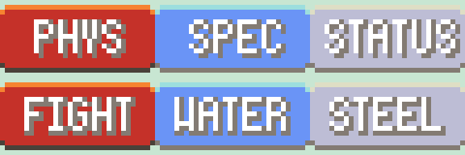

## Supported ROMs

| Patch file | Use it on | CRC32 | SHA-1 |
|---|---|---|---|
| `Ruby_PhysSpecSplit_v1.0.bps` | **Pokémon Ruby Version (USA, Europe)** v1.0, game code `AXVE`, revision 0 | `F0815EE7` | `f28b6ffc97847e94a6c21a63cacf633ee5c8df1e` |
| `Ruby_PhysSpecSplit_v1.1.bps` | **Pokémon Ruby Version (USA, Europe) (Rev 1)** | `61641576` | `610b96a9c9a7d03d2bafb655e7560ccff1a6d894` |
| `Ruby_PhysSpecSplit_v1.2.bps` | **Pokémon Ruby Version (USA, Europe) (Rev 2)** | `AEAC73E6` | `5b64eacf892920518db4ec664e62a086dd5f5bc8` |
| `Sapphire_PhysSpecSplit_v1.0.bps` | **Pokémon Sapphire Version (USA, Europe)** v1.0, game code `AXPE`, revision 0 | `554DEDC4` | `3ccbbd45f8553c36463f13b938e833f652b793e4` |
| `Sapphire_PhysSpecSplit_v1.1.bps` | **Pokémon Sapphire Version (USA, Europe) (Rev 1)** | `BAFEDAE5` | `4722efb8cd45772ca32555b98fd3b9719f8e60a9` |
| `Sapphire_PhysSpecSplit_v1.2.bps` | **Pokémon Sapphire Version (USA, Europe) (Rev 2)** | `9CC4410E` | `89b45fb172e6b55d51fc0e61989775187f6fe63c` |

* Use the **Ruby** patches on Ruby and the **Sapphire** patches on Sapphire, and pick the
  one for your revision.
* Only the **English (USA, Europe)** releases are supported, not other languages.
* Not sure which revision you have? The ROM's file name usually says "(Rev 1)" or
  "(Rev 2)". Otherwise compare its CRC32 or SHA-1 with the table.

## In-game

**Summary screen → BATTLE MOVES → press A on a move.** A PHYS / SPEC / STATUS badge appears
at the right end of the DESCRIPTION header, next to the move's description and POWER /
ACCURACY. This is also the screen you get when you **learn a new move by level-up or TM
with four moves already known**, so you can see the new move's category before you choose
a move to forget. The badge isn't shown on the CONTEST MOVES page.

| Special | Physical | Status |
|---|---|---|
| 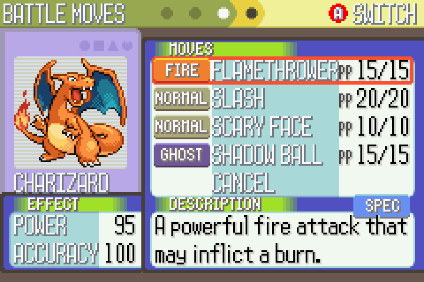 | 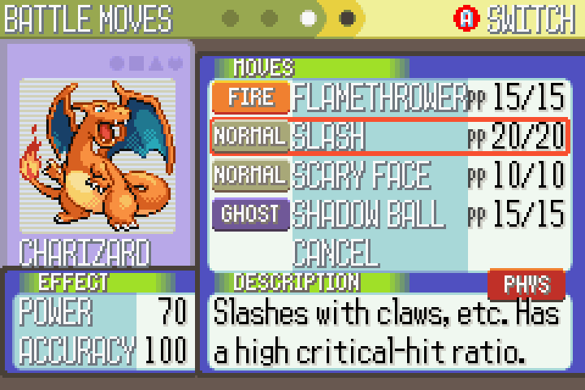 | 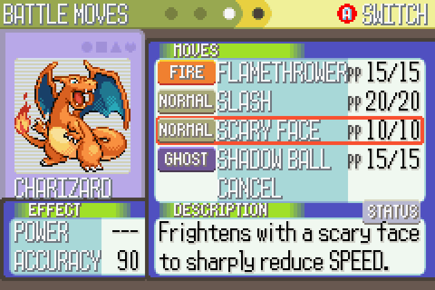 |

| Learning a new move (Earthquake) | Shadow Ball is now Special |
|---|---|
| 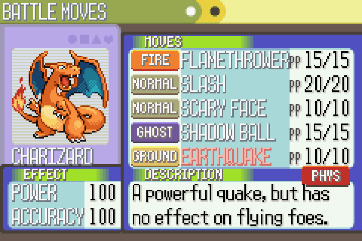 | 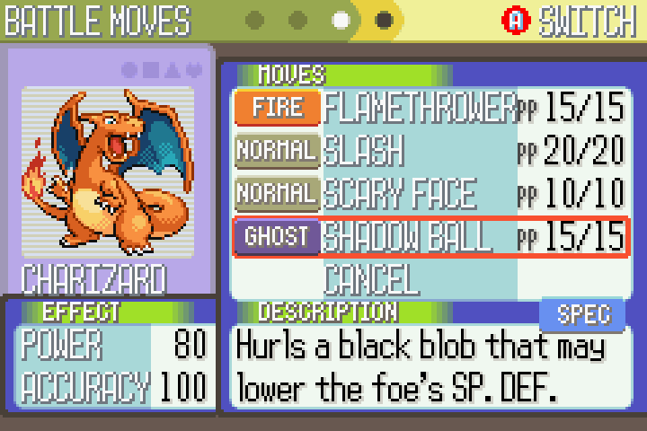 |

**Move Tutor / relearner** (Fallarbor Town): the BATTLE panel shows the category under
ACCURACY. POWER and ACCURACY moved up a row to make room.

| Physical | Status | Special |
|---|---|---|
| 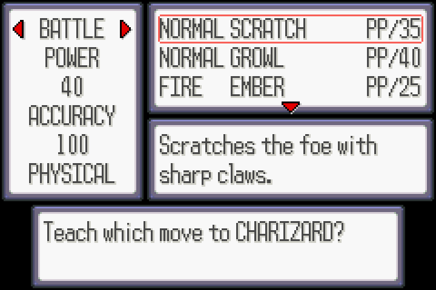 | 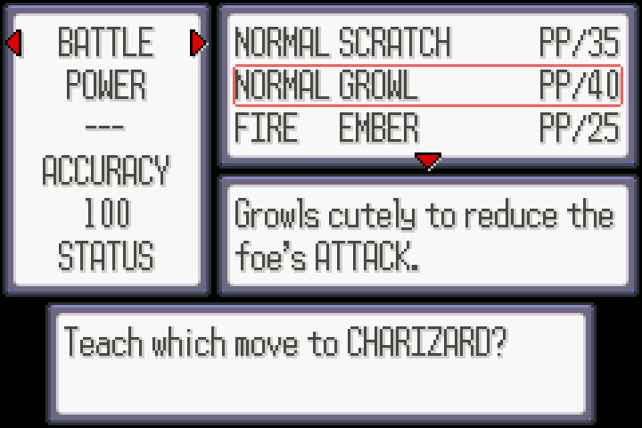 | 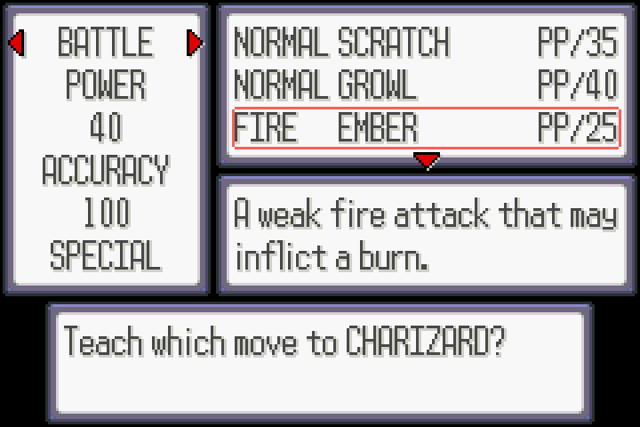 |

**Bag → TMs & HMs pocket:** the selected TM/HM's type and category are shown stacked in the
empty space beside the bag (they hide on CLOSE BAG and in the other pockets).

| Status | Physical | Special |
|---|---|---|
| 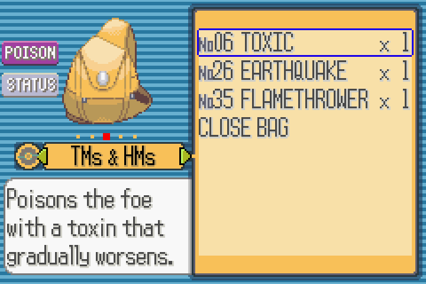 | 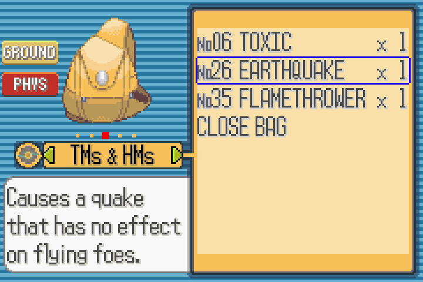 | 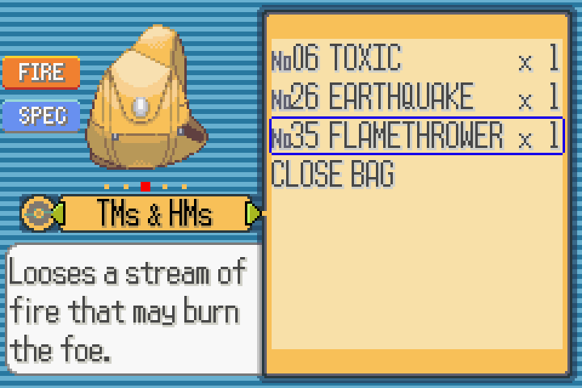 |

(The summary and Move Tutor screenshots are from Sapphire and the Bag ones from Ruby;
the two games look the same apart from the bag colour.)

## Source changes

Built from [pret/pokeruby](https://github.com/pret/pokeruby) at commit
`5784633ce4ef7ade1a7f2d2d0c288e3d5e6cdd7f`. Every change is in
[`source/phys-spec-split.diff`](source/phys-spec-split.diff), including the build and test
tools under `patch_tools/`.

| File | Change |
|---|---|
| `include/constants/pokemon.h` | `SPLIT_PHYSICAL` / `SPLIT_SPECIAL` / `SPLIT_STATUS` constants (here so the AI script can use them too) |
| `include/pokemon.h` | new `u8 split;` field in `struct BattleMove` (uses existing padding; still 12 bytes per move) |
| `src/data/battle_moves.c` | `.split = SPLIT_…,` added to every move |
| `include/battle.h` | `IS_MOVE_PHYSICAL(move)` / `IS_MOVE_SPECIAL(move)` replace the old type-based macros |
| `src/calculate_base_damage.c` | `CalculateBaseDamage` picks stats by the move's category |
| `src/battle_script_commands.c` | Hustle accuracy, Counter/Mirror Coat damage tracking |
| `graphics/types/split_physical.png`, `split_special.png`, `split_status.png` | the three badges (new files, 32×16, same palettes as the type icons) |
| `misc.mk` | appends the badges to the type-icon sprite sheet |
| `src/pokemon_summary_screen.c` | badge sprite in sprite slot 5 (`SPLIT_ICON_SPRITE_SLOT`, `SpriteCB_SplitIcon`, `SetSplitIconMove`) |
| `src/move_tutor_menu.c` | Move Tutor: POWER/ACCURACY rows moved up and a category row added (`sMoveInfoTextCoords`, `PrintMoveInfo` case 8) |
| `include/pokemon_summary_screen.h` | shares the move type icon sprite sheet/animations/palette map (`gSpriteSheet_MoveTypes` etc.) with the bag |
| `src/item_menu.c` | Bag TMs & HMs pocket: type + category icons (`LoadTmIconGfx`, `CreateTmIconSprites`, `SpriteCB_TmIcon`, which reads the selected item itself each frame) |
| `src/battle_ai_script_commands.c` | trainer AI: new script commands in the unused slots 0x52–0x54: `get_move_split_from_result`, `if_target_physical_attacker`, `if_target_special_attacker` (the target's Attack vs Sp. Atk) |
| `include/macros/battle_ai_script.inc` | macros for those commands |
| `data/battle_ai_scripts.s` | the AI's type lists for Reflect, Light Screen, Counter, Mirror Coat, Attack/Sp. Atk drops and Defense/Sp. Def boosts replaced by those commands |

### Common edits

* **Change a move's category:** edit its `.split` in `src/data/battle_moves.c`, e.g.
  ```c
  [MOVE_BITE] = { ..., .split = SPLIT_PHYSICAL, },
  ```
* **Change the badge art:** edit `graphics/types/split_*.png`. Keep them 32×16 indexed
  PNGs using the type-icon palettes (`move_types_1.pal` for PHYS/STATUS, `move_types_2.pal`
  for SPEC; see `sMoveTypeToOamPaletteNum`).
* **Move the badge on screen:** change `SPLIT_ICON_X` / `SPLIT_ICON_Y` in
  `pokemon_summary_screen.c`, or `TM_ICON_X` / `TM_ICON_Y` in `item_menu.c` for the Bag.
* **Rename the Move Tutor text:** `sText_SplitPhysical` etc. in `move_tutor_menu.c`.

## Build targets

`./setup.sh ruby-sapphire` creates a working copy in `work/pokeruby`.

| Patch | `make` target | Built ROM | Vanilla `compare` target |
|---|---|---|---|
| `Ruby_PhysSpecSplit_v1.0.bps` | `ruby` | `pokeruby.gba` | `compare_ruby` |
| `Ruby_PhysSpecSplit_v1.1.bps` | `ruby_rev1` | `pokeruby_rev1.gba` | `compare_ruby_rev1` |
| `Ruby_PhysSpecSplit_v1.2.bps` | `ruby_rev2` | `pokeruby_rev2.gba` | `compare_ruby_rev2` |
| `Sapphire_PhysSpecSplit_v1.0.bps` | `sapphire` | `pokesapphire.gba` | `compare_sapphire` |
| `Sapphire_PhysSpecSplit_v1.1.bps` | `sapphire_rev1` | `pokesapphire_rev1.gba` | `compare_sapphire_rev1` |
| `Sapphire_PhysSpecSplit_v1.2.bps` | `sapphire_rev2` | `pokesapphire_rev2.gba` | `compare_sapphire_rev2` |

